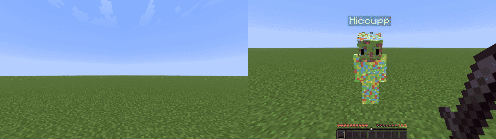
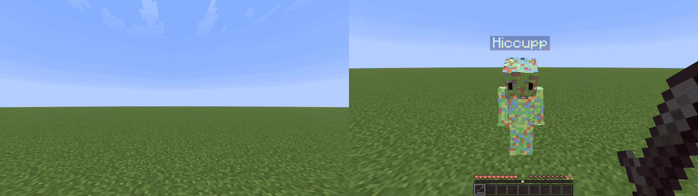
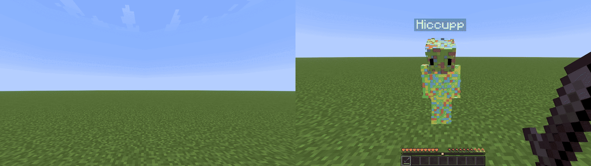
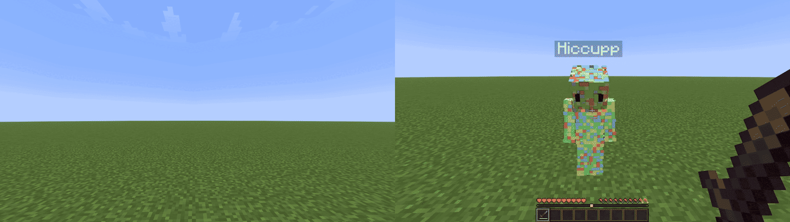
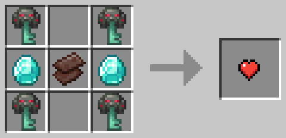
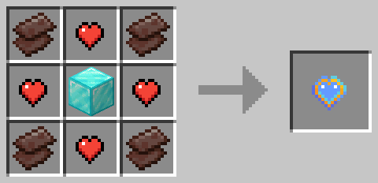

# Lifesteal Enhanced
A paper plugin which aims to re-create the lifesteal concept but with some unique features.

---

## Core Features
- When you kill a player you steal their heart (options to drop the heart on death or add it directly to the killer's hearts)
- When a player dies to natural causes they lose a heart (can be configured to drop it on the ground)
- When a player loses all their hearts, or reaches the minimum, they ether can respawn and not lose a heart or can be banned until revived (can be configured)
- Players can use a revive item to revive banned players (customizable recipe)
- Players can also craft hearts with a customizable recipe.
- You can use the `/withdraw` command to withdraw hearts.

## Stand-Out Features
- Option to ether get banned after death on minimum hearts or just not lose a heart (the killer doesn't get the heart ether in this case)
- Customizable recipes for heart and revive
- Ability to take hearts out of people's ender chests and inventory (can be customized or disabled in the config)
- Ability to choose what containers hearts can be stored in
- Customizable damage immunity and void immunity for hearts
- Customizable limits for crafting hearts (maximum hearts the player is allowed to be on to be able to craft a heart, it counts hearts in ender chest and inventory for the calculation)

## Configuration

<details>
<summary>
<b> Heart Removal Priority </b>
</summary>


### Example 1
```yaml
heart-removal-priority:
  - "BAR"
  - "INV"
  - "E-CHEST"
```

1. `BAR` It takes a heart from the max health of the player, if they're at the minimum, it moves to the next option.
2. `INV` It looks for heart items in the player's inventory and takes one if possible. If none are found, it moves on to the next option.
3. `E-CHEST` It looks for hearts in the player's enderchest and takes one if possible, otherwise it either bans you or doesn't give the killer a heart depending on what `ban-bellow-min` is set to.


### Example 2 (Default Lifesteal)

```yaml
heart-removal-priority:
  - "BAR"
#  - "INV"
#  - "E-CHEST"
```

In this example it works just as normal lifesteal, it takes a heart straight from your max health. If you're at minimum health then it either bans you or doesn't give the killer a heart depending on what `ban-bellow-min` is set to.

### Example 3

```yaml
heart-removal-priority:
  - "INV"
  - "E-CHEST"
  - "BAR"
```

1. `INV` If there are hearts in the player's inventory, take them instead of their maximum health. If not move on to the next option.
2. `E-CHEST` Same thing as before but if they are in the player's ender chest.
3. `BAR` If the player is above minimum hearts then take one of their maximum health, if not then it either bans you or doesn't give the killer a heart depending on what `ban-bellow-min` is set to.

</details>

<details>
<summary>
<b> Heart Dropping Behavior </b>
</summary>


```yaml
# NONE : none of the options, will still drop if the killer has max hearts and no inventory space (if give-item-on-max is true)
# KILL : always drop when a player is killed or credited for a death
# UNCREDITED : drop the heart item on player death even from a trap or accidental death but not from a kill
# ALWAYS : always drop a heart on player death
drop-on-kill: NONE
```

### `drop-on-kill: NONE`


### `drop-on-kill: KILL`


### `drop-on-kill: UNCREDITED`


### `drop-on-kill: ALWAYS`



</details>

<details>
<summary>
<b> Recipes </b>
</summary>

#### Shaped:

```yaml
recipe:
  enabled: true
  type: SHAPED
  shape:
    - "NHN"
    - "HDH"
    - "NHN"
  ingredients:
    N: NETHERITE_SCRAP
    H: HEART
    D: DIAMOND_BLOCK
```
- `enabled`: Enabled or disables the recipe, if disabled you cant craft the item.
- `type`: The recipe type, can be `SHAPED` (e.g. beacon) or `SHAPELESS` (e.g. shears).
- `shape`: The pattern of the recipe in a 3x3 grid, the letters represent items that you define in the `ingredients` section.
- `ingredients`: Where to define the letters used in the shape/pattern of the recipe. You define items in full caps, for example `GOLD_INGOT`. There are two custom items which you can use for ingredients, they are `HEART` and `REVIVE`.

---
#### Shapeless:
```yaml
recipe:
  enabled: true
  type: SHAPELESS
  ingredients:
    NETHERITE_SCRAP: 5
    HEART: 2
    DIAMOND_BLOCK: 1
```
- `enabled`: Enabled or disables the recipe, if disabled you cant craft the item.
- `type`: The recipe type, can be `SHAPED` (e.g. beacon) or `SHAPELESS` (e.g. shears). A shapeless recipe means that when crafting it only matters what ingredients you use. 
- `ingredients`: Where you define the ingredients and quantities of the recipe. The first value is the item name in full caps, the second is the quantity.

</details>


<details>
<summary>
<b> Default Config </b>
</summary>

### Default Recipes



---

### Raw File

```yaml
minimum-hearts: 3.0
maximum-hearts: 15.0

# Whether to ban people if they die at minimum hearts
ban-bellow-min: true

items:
  revive:
    enabled: true
    revived-hearts: 3.0 # How many hearts to give the revived player
    recipe:
      enabled: true
      type: SHAPED
      shape:
        - "NHN"
        - "HDH"
        - "NHN"
      ingredients:
        N: NETHERITE_SCRAP
        H: HEART
        D: DIAMOND_BLOCK

  heart:
    enabled: true

    # Whether the hearts glow when dropped on the ground
    glowing: false

    # Give a killer the heart item if they are on max hearts when killing someone
    give-item-on-max: false

    # NONE : none of the options, will still drop if the killer has max hearts and no inventory space (if give-item-on-max is true)
    # KILL : always drop when a player is killed or credited for a death
    # UNCREDITED : drop the heart item on player death even from a trap or accidental death but not from a kill
    # ALWAYS : always drop a heart on player death
    drop-on-kill: NONE

    storable-locations:
      E-CHEST: true
      ALL-CONTAINERS: false

    heart-removal-priority: # Which order to take hearts from and where to take from, comment out places that you don't want to be touched on death
      - "BAR"
      - "INV"
      #- "E-CHEST"

    immunity:
      void-immunity: true
      despawn-immunity: true
      damage-immunity: true

    recipe:
      enabled: true
      restrictions:
        enabled: false
        maximum-hearts: 10.0dr
      type: SHAPED
      shape:
        - "K K"
        - "DND"
        - "K K"
      ingredients:
        K: OMINOUS_TRIAL_KEY
        D: DIAMOND
        N: NETHERITE_SCRAP
```
</details>

## Resource Pack
Enter these values into your server.properties to set the pack as a default on your server.
```properties
resource-pack=https://download.mc-packs.net/pack/68e5107905464e726093cb370fe723bba339561b.zip
resource-pack-sha1=68e5107905464e726093cb370fe723bba339561b
resource-pack-id=6680eec6-9185-439e-8e55-064bc5f6cd00
resource-pack-prompt={"text":"This server uses a custom resource pack for lifesteal.", "color":"gold"}
require-resource-pack=true
```

## Operator Commands

|Command|  Description|
|---------------------------|---|
|`/lifesteal hearts set <player> <ammount>`|Sets the amount of hearts that the selected player has.|
|`/lifesteal hearts get <player>`|Gets the amount of hearts that the selected player has.  |
|`/lifesteal hearts add <player> <amount>`                |Adds an amount of hearts to the selected player.    |
|`/lifesteal hearts remove <player> <amount>`     |Removes an amount of hearts from the selected player.|
|`/lifesteal give <item> <player> <amount>`|Gives a player an item from the plugin. For `<item>` it can be ether `heart` or `revive`.|
|`/lifesteal reload`|Reloads the plugin's config from `config.yml`.|
|`/withdraw <amount>`|Takes your heart and turns it into a heart item, `<amount>` option is optional.|

